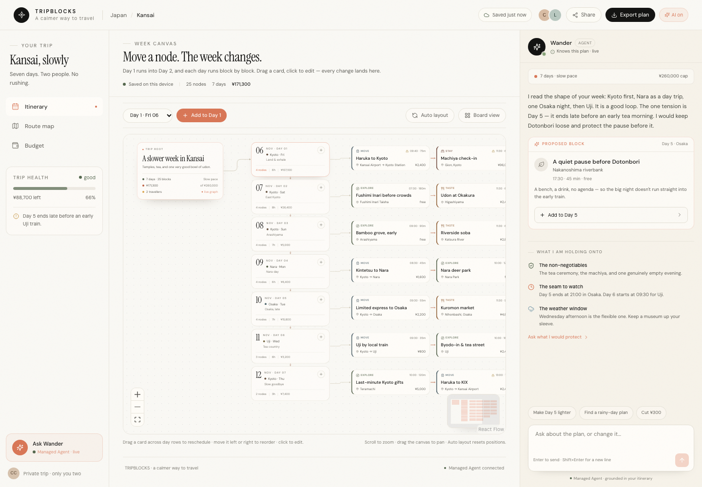
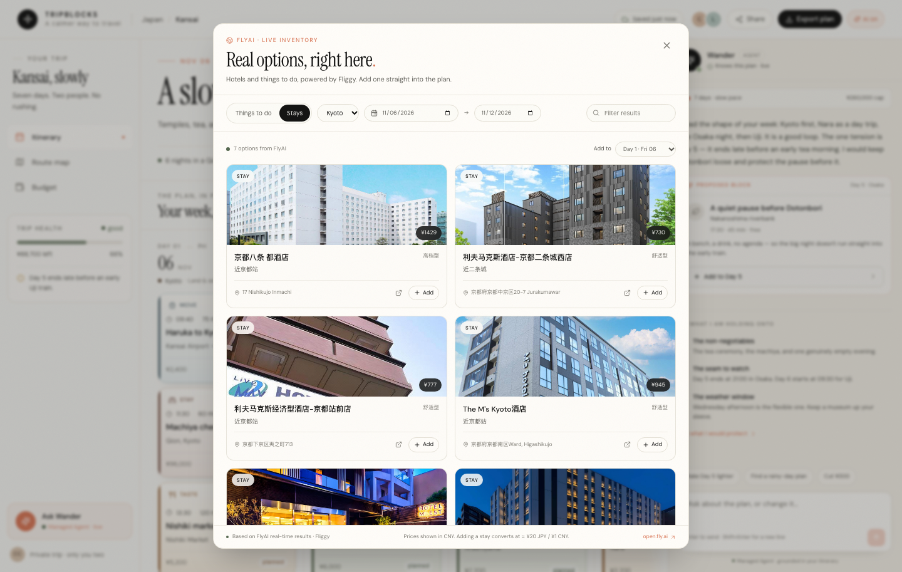
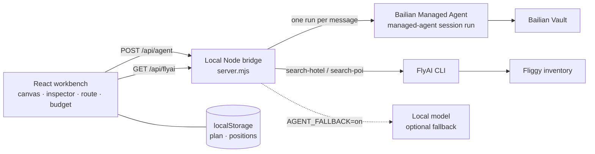

# TripBlocks

**A calmer way to plan a trip — the week as a live graph, not a generated itinerary.**

TripBlocks is a local-first travel workspace. The plan is a live node tree: the trip at the root, the week's days chained down the canvas, and each day's transport, stays, food and experiences running left to right in time order. Drag a block and its day, start time and order change; cost and route follow. The traveler and an AI agent work on the same graph: Wander can propose a card, you accept, edit or discard it.

Real hotel and attraction inventory comes from **FlyAI / Fliggy**, with prices, images and booking links; any result can become a block in a day.

Built for the **2026 飞猪 AI 旅行创新大赛**.

[Live landing](https://37chengshan.github.io/tripblocks/) ·
[Demo workbench](https://37chengshan.github.io/tripblocks/demo.html) ·
[Architecture map](https://37chengshan.github.io/tripblocks/architecture.html) ·
[25 s demo video](docs/demo/tripblocks-demo.mp4) ·
[Competition entry](https://github.com/modelstudioai/modelstudioai.github.io/issues/203)



## The thesis

An itinerary is not a document. It is a set of coupled decisions: move one afternoon and the hotel night, the budget and the next morning all move with it. Most AI planners hide that coupling behind a chat transcript and a wall of generated text. TripBlocks keeps the plan itself as the interface — visible, editable and grounded in real inventory.

## What you can do

- **Plan on a living canvas.** Itinerary, route and budget in the left sidebar; a trip → day → block graph in the center; Wander on the right. Add, select, drag and edit without leaving the canvas.
- **Drag means reschedule.** Crossing a day lane rewrites `dayId`, start time and order; dropping inside a day reorders and re-times. Node positions are layout state, not the schedule.
- **Ask an agent that sees the whole plan.** Wander receives a compacted itinerary — days, places, times, costs, notes — and answers briefly. It may return one suggested block. Suggestions arrive as cards; nothing enters the plan until you add it.
- **Ground it in real inventory.** From Board view, Live options searches Fliggy through FlyAI for stays and things to do, with images, prices, addresses and booking links. Add a result to any day.
- **Keep the week honest.** Route map, daily spend, remaining budget and pace are visible in the same workspace, not a separate report.
- **Stay local-first.** The plan and canvas positions persist in `localStorage`; export is a JSON file. No sign-in to edit, no hosted plan state.

## See it

| Live FlyAI inventory | Demo workbench |
|---|---|
|  |  |
| *Real Fliggy stays, prices and booking links, addable to a day.* | *The full Kansai graph and saved conversations. No composer.* |

| Landing | Architecture |
|---|---|
|  |  |
| *An editorial field note, drawn in SVG and CSS.* | *The real request paths, node by node.* |

The three public pages are deliberately separate:

- **Landing** — the product argument and a way into the workbench.
- **Demo workbench** — a static version of the Kansai plan with read-only conversations. Drag and edit nodes locally; two saved Managed Agent conversations and one saved local draft; **no composer, no model, no inventory calls**.
- **Architecture map** — an interactive map of the actual request paths.

## Architecture



The bridge is deliberately small. `/api/agent` sends the compacted trip and the user message in a single `bl managed-agent session run` call — a 55 s browser timeout and a 52 s CLI timeout, no polling, no background loop. `/api/flyai` shells out to the official FlyAI CLI and caches results for 10 minutes. If the Managed Agent call fails, the bridge can retry a local OpenAI-compatible model (`LOCAL_MODEL_BASE_URL`, default `http://127.0.0.1:10100/v1`); set `AGENT_FALLBACK=off` to disable the retry and return a 503.

Replies carry `source: managed-agent` or `source: local`, and the UI labels them. If no model is reachable at all, the frontend uses a deterministic draft and marks it local — it never presents canned text as a model answer. API keys live in the Bailian CLI/Vault or the server environment, never in the page.

## Run locally

Requirements: **Node 20.19+ or 22.12+** and npm. The live agent and FlyAI inventory need a funded Bailian account and a FlyAI key; the public demo needs neither.

```bash
npm install
npm run dev:all
```

- Web: `http://127.0.0.1:5173`
- API bridge: `http://127.0.0.1:8787`

`npm run dev` starts Vite alone. The canvas still works, but the agent falls back to the local draft and inventory stays unavailable.

### Credentials

```bash
# Bailian Managed Agent — bailian-cli is already a dev dependency
npx bl auth login --console

# FlyAI / Fliggy inventory
npx flyai config set FLYAI_API_KEY "your-key"
```

Agent definitions live in `agent/agents.yaml` (`admin`, environment `dev-2`, Vault `admin`). The bridge invokes it with `--file agent/agents.yaml`. Keep real credentials in the CLI, Vault or environment, never in this repository or the browser.

| Variable | Default | Purpose |
|---|---|---|
| `PORT` | `8787` | Bridge port |
| `BL_BIN` | local `.bin/bl`, else `bl` | Bailian CLI |
| `FLYAI_BIN` | `node_modules/.bin/flyai`, else `flyai` | FlyAI CLI |
| `AGENT_FALLBACK` | `on` | Set `off` to disable the local-model retry |
| `LOCAL_MODEL_BASE_URL` | `http://127.0.0.1:10100/v1` | Fallback OpenAI-compatible endpoint |
| `LOCAL_MODEL` | `intern/qwen3.8-27b` | Fallback model |
| `DASHSCOPE_API_KEY`, `BAILIAN_BASE_URL` | — | Read by `agent/agents.yaml` when set |

## Project map

```text
src/
  App.tsx                 plan state, views, agent and FlyAI wiring
  components/
    CanvasBoard.tsx       React Flow canvas; drag → day, start, order
    TripBoard.tsx         alternate day board with Live options
    Inspector.tsx         block editor
    Companion.tsx         Wander conversation UI
    FlyAISheet.tsx        live stay / POI inventory
    RouteMap.tsx          route view
    BudgetView.tsx        spend view
  lib/agent.ts            /api/agent client + labeled local draft
  data.ts                 seeded 7-day Kansai trip
server.mjs                local bridge and production static server
agent/                    Managed Agent config and resource state
site/                     Pages bundle: landing, demo, architecture
docs/COMPETITION.md       requirement mapping and 3-minute demo script
docs/screenshots/         README images
docs/demo/                25.6 s demo video
.github/workflows/        Pages deployment
```

## Competition mapping

| Requirement | Implementation |
|---|---|
| Bailian Managed Agent | `server.mjs` calls `bl managed-agent session run`; config in `agent/agents.yaml` |
| Vault binding | Agent bound to Vault `admin`; API keys stay server-side |
| FlyAI Skill / CLI | Official `@fly-ai/flyai-cli`; `/api/flyai` runs `search-hotel` and `search-poi` |
| Real hotel / attraction inventory | Live options sheet with images, prices, addresses and Fliggy links |
| Reproducible product | Public landing, demo and architecture pages; 25.6 s video; `npm install && npm run dev:all` |
| Competition submission | [issue #203](https://github.com/modelstudioai/modelstudioai.github.io/issues/203) |

**Live status:** FlyAI is live. The Managed Agent runs live once the Bailian account has credit and an API key is created. The public Pages build stays static by design.

## Limits

- **The Pages demo is a static snapshot.** It has no chat backend or composer and makes no model or inventory calls. The full loop needs local Node plus Bailian/FlyAI credentials.
- **Currency is approximate.** FlyAI prices are CNY; adding a priced result to the JPY plan converts at ≈ ¥20 JPY / ¥1 CNY and writes the estimate into the block note.
- **No booking execution.** Payments, ticketing, multi-user sync and live flight availability are not implemented.
- **The agent is single-turn.** It proposes at most one block per reply and never writes to the plan without confirmation.

## License

No open-source license is declared yet; the source is published for the competition and review. Add a license before reuse. Third-party names, inventory imagery and booking links belong to their respective owners.
