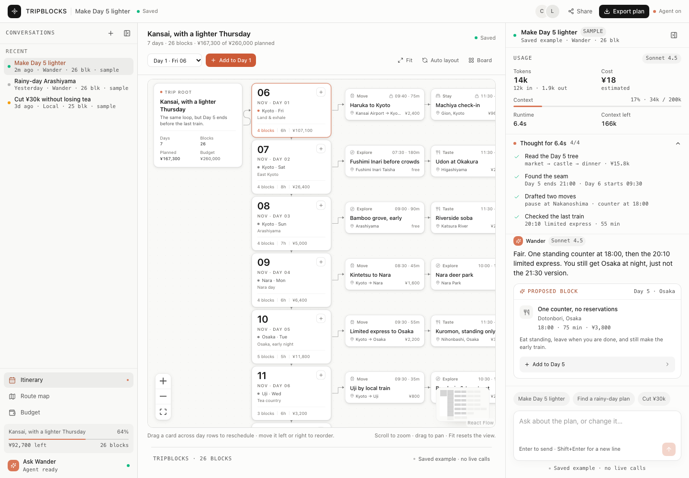
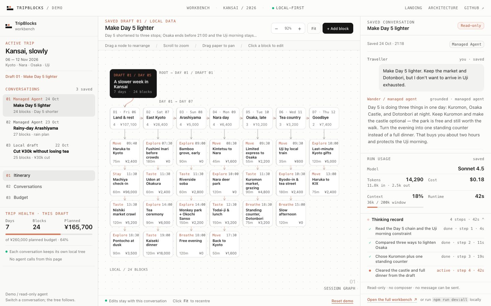
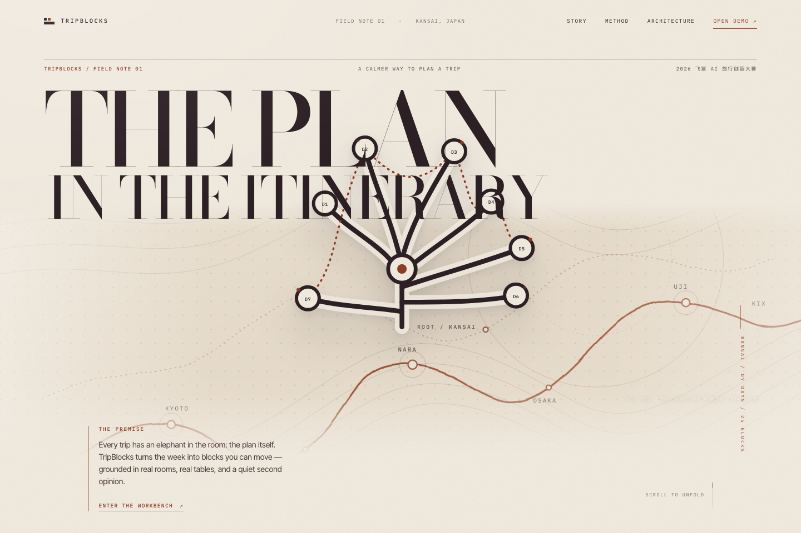
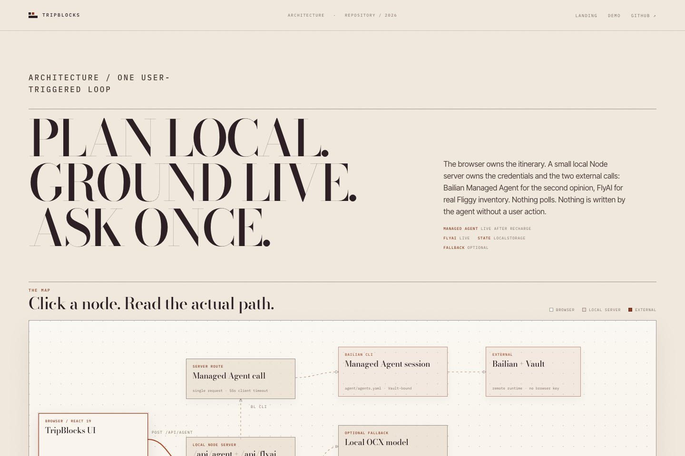
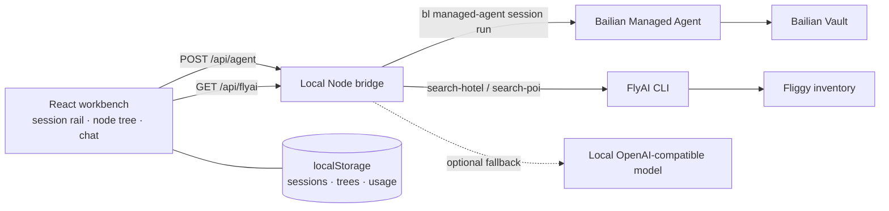

# TripBlocks

**A live travel workbench where every conversation owns its own week.**

TripBlocks is a session-centric travel planner. The left rail is a list of conversations; each conversation has its own trip tree. The centre is that tree: a horizontal root → day → block graph that can be dragged, clicked and edited. The right rail is the same conversation, plus its token/context/cost usage and the agent's thinking stream.

Built for the **2026 飞猪 AI 旅行创新大赛**.

[Live landing](https://37chengshan.github.io/tripblocks/) ·
[Read-only demo](https://37chengshan.github.io/tripblocks/demo.html) ·
[Architecture](https://37chengshan.github.io/tripblocks/architecture.html) ·
[25.6 s demo video](docs/demo/tripblocks-demo.mp4) ·
[Competition entry](https://github.com/modelstudioai/modelstudioai.github.io/issues/203)



## Why it is different

Most itinerary tools collapse a trip into one long generated document. TripBlocks keeps **three things visible at once**:

1. **Conversations are the workspace.** “Make Day 5 lighter”, “Rainy-day Arashiyama” and “Cut ¥30k without losing tea” are three independent sessions with different trees, budgets and saved transcripts. Switching sessions switches the graph, not just the chat text.
2. **The tree is the plan.** Drag a block across a day row to change its day, time and order; drag within a row to reorder. Click any node to edit its title, place, start time, duration, cost and note. The graph is derived from the same trip data as the board, budget and route.
3. **The agent is inspectable.** The right panel shows the conversation, a usage block (model, input/output tokens, estimated cost, context used/limit, runtime) and a collapsible thinking stream. The agent can propose a block, but nothing is added until the traveller accepts it.
4. **Real inventory.** FlyAI / Fliggy results add live hotels and attractions, with images, prices and booking links, into any day.
5. **Local-first.** Sessions, trees, transcripts, usage and node positions persist in `localStorage`; export is plain JSON.

## The shell

```text
┌────────────────────────────────────────────────────────────┐
│ 48px titlebar · session title · status · share/export     │
├──────────────┬───────────────────────────┬─────────────────┤
│ conversations│ live node tree            │ conversation    │
│ 288px        │ root → days → blocks      │ 384px           │
│ / 64px rail  │ drag · edit · fit · pan   │ usage · thought │
│              │                           │ composer        │
└──────────────┴───────────────────────────┴─────────────────┘
```

- The left rail collapses to a 64px icon rail and remembers the state.
- The right panel collapses to a 48px hook and remembers the state.
- The shell uses neutral CDS surfaces (`#f9f9f7` rail, `#fcfcfb` centre/right, `#fff` cards), a single clay accent (`#d97757`), neutral hairlines and no page grain.
- The editorial landing is deliberately separate; it uses SVG/CSS geometry and no photography.

## Screens

| Session workbench | Read-only demo |
|---|---|
|  |  |

| Editorial landing | Architecture |
|---|---|
|  |  |

- **Landing** — the argument, the field-note visual language and links into the demo.
- **Demo workbench** — three conversations with three frozen trees, read-only transcripts, usage and thinking. The graph is locally draggable/editable; there is **no chat composer** and no model call.
- **Full workbench** — local app with live Managed Agent and FlyAI bridges.

## Architecture



Keys stay server-side. `/api/agent` runs Managed Agent only on a user message, one call per turn, with a 55 s browser timeout; `/api/flyai` shells out to the official FlyAI CLI and caches for 10 minutes. If the agent bridge is unavailable, responses are explicitly labelled as local fallback/local draft.

[Explore the interactive architecture map →](https://37chengshan.github.io/tripblocks/architecture.html)

## Run

Requirements: Node 20.19+ / 22.12+, npm. The public demo needs no credentials; the live workbench needs a funded Bailian account and a FlyAI key.

```bash
npm install
npm run dev:all
```

- Web: `http://127.0.0.1:5173`
- API bridge: `http://127.0.0.1:8787`

```bash
# Bailian Managed Agent
npx bl auth login --console

# FlyAI / Fliggy
npx flyai config set FLYAI_API_KEY "your-key"
```

Agent resources live in `agent/agents.yaml`; the bridge uses `--file agent/agents.yaml` and environment `dev-2`, Vault `admin`.

| Variable | Default | Purpose |
|---|---|---|
| `PORT` | `8787` | Bridge port |
| `BL_BIN` | local `.bin/bl`, else `bl` | Bailian CLI |
| `FLYAI_BIN` | `node_modules/.bin/flyai` | FlyAI CLI |
| `AGENT_FALLBACK` | `on` | Set `off` to disable the local-model fallback |
| `LOCAL_MODEL_BASE_URL` | `http://127.0.0.1:10100/v1` | Optional fallback endpoint |
| `LOCAL_MODEL` | `intern/qwen3.8-27b` | Optional fallback model |

## Competition mapping

| Requirement | Implementation |
|---|---|
| Bailian Managed Agent | `/api/agent` → `bl managed-agent session run`; config in `agent/` |
| Vault | Agent bound to Vault; keys never reach the browser |
| FlyAI Skill / CLI | Official `@fly-ai/flyai-cli`; `/api/flyai` searches stays and attractions |
| Session workbench | Three saved conversations, each with its own tree, transcript, usage and thinking |
| Live inventory | Hotel/attraction sheet with images, prices, addresses and Fliggy links |
| Submission | [issue #203](https://github.com/modelstudioai/modelstudioai.github.io/issues/203) |

**Status:** Managed Agent is live after account recharge/API-key creation; FlyAI is live. The GitHub Pages build is intentionally static — the demo has no chat composer and makes no model or inventory calls.

## Limits

- The Pages demo is a static snapshot; the full composer and live bridges require local Node plus credentials.
- FlyAI prices are CNY; adding to the JPY plan uses ≈¥20 JPY / ¥1 CNY and writes the estimate into the note.
- No payments, booking execution, multi-user sync or flight ticketing.
- The agent is single-turn; it proposes at most one block per reply and never writes without confirmation.

## Project map

```text
src/
  App.tsx                 session store, active tree, views, agent/FlyAI wiring
  components/
    SideRail.tsx          288px conversation rail / 64px icon rail
    CanvasBoard.tsx       React Flow tree; drag→day/time/order; fit/pan
    Companion.tsx         transcript · usage · thinking · composer
    TripBoard.tsx         alternate day board
    Inspector.tsx         node editor
    FlyAISheet.tsx        live stay / attraction inventory
  data.ts                 three seeded sessions, trees, usage, thinking
server.mjs                /api/agent, /api/flyai, static server
site/                     editorial landing, read-only demo, architecture
agent/                    Managed Agent config and resource state
docs/COMPETITION.md       competition mapping and demo script
docs/demo/                25.6 s demo video
.github/workflows/        GitHub Pages deployment
```

## Design notes

The workbench follows the open-claude-ui CDS language: neutral surfaces, 12px cards, 8/10/12/16/999 radii, 1px alpha hairlines, clay accent only for state/action, 14px conversation body, 11px meta, 580 semibold headings. Thinking uses a CSS grid `0fr/1fr` accordion; near-bottom chat pinning uses a 40px tolerance and a 150ms permission window; motion is transform/opacity, 60–300ms, with `prefers-reduced-motion` fallbacks.

## License

No open-source license is declared yet; source is published for the competition and review. Third-party names, inventory imagery and booking links belong to their respective owners.
