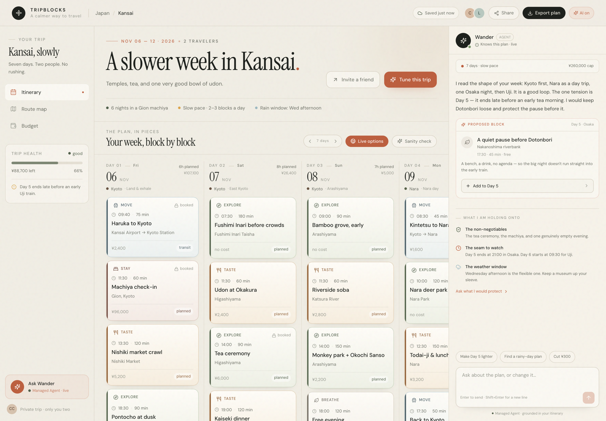

# TripBlocks

> A calmer way to plan a trip — one block at a time.
> 2026 飞猪 AI 旅行创新大赛参赛作品



TripBlocks 是一个模块化的旅行计划台：把交通、住宿、体验、吃饭和留白做成可拖拽的「块」，让行程从一张待办清单变成可以呼吸的周计划。右侧的 **Wander** 接阿里云百炼 Managed Agent，实时读取当前计划；真正的酒店与景点库存由 **FlyAI / 飞猪** 提供。

## 核心体验

- **Block board** — 7 天横向计划板，跨天拖拽，块内编辑时间、地点、预算和备注。
- **Live FlyAI inventory** — 一键打开真实酒店 / 景点库存，含图片、价格、评分、飞猪预订链接；可直接加入某一天。
- **Wander** — 接 Managed Agent 的对话伙伴，读取完整行程上下文，给出「让 Day 5 轻一点」这类具体建议；建议块可一键加入计划。
- **Route map & budget** — 路线可视化、每日消费构成、预算余量、已知冲突提示。
- **Local-first** — 行程保存在本地；不登录也能完整编辑；AI 不可用时仍有确定性的本地草稿回复。

## 运行

```bash
npm install
npm run dev:all
# Web: http://127.0.0.1:5173
# API: http://127.0.0.1:8787
```

也可以分开启动：

```bash
npm run server
npm run dev
```

### FlyAI

FlyAI CLI 已作为项目依赖安装（`@fly-ai/flyai-cli`）。配置一次 API Key：

```bash
npx flyai config set FLYAI_API_KEY "your-key"
```

`server.mjs` 会优先使用 `node_modules/.bin/flyai`，因此不需要全局安装。没有 Key 时 CLI 也可能返回试用结果；正式演示建议配置。

官方 FlyAI Skill：

```bash
npx skills add alibaba-flyai/flyai-skill
```

### Managed Agent

浏览器只访问本地 `/api/agent`，密钥和 CLI 调用留在服务端。服务端通过 `bl managed-agent session run` 使用 `agent/agents.yaml` 中的 Agent 配置；`agent/agents.state.json` 记录了已导入的远程 Agent / Environment / Vault 资源。

首次使用需要：

```bash
npm i -g bailian-cli
bl auth login --console
```

然后确保 `agent/agents.yaml` 指向你有权限的 Agent 与 Environment。当前仓库已接入比赛用的 Managed Agent 与 Vault；如果你复制到别的账号，请重新 `bl managed-agent state import` 或按 `bl managed-agent init` 新建。

> **费用提示**：`/api/agent` 仅在用户主动发送消息时调用一次，没有轮询。Managed Agent 的会话运行时费只在 running 时计费。Agent 不可用时，服务端会回退到本地 OCX 的 `intern/qwen3.8-27b`（不是百炼账单里的 AutoModel）；如果不想使用任何 fallback，启动时设置 `AGENT_FALLBACK=off`，前端仍会使用不调用模型的本地草稿。

### 可选环境变量

| 变量 | 默认 | 说明 |
|---|---|---|
| `PORT` | `8787` | API 端口 |
| `BL_BIN` | `bl` | 百炼 CLI |
| `FLYAI_BIN` | `node_modules/.bin/flyai` | FlyAI CLI |
| `FLYAI_API_KEY` | `flyai config` | FlyAI 密钥（推荐用 CLI 配置） |
| `AGENT_FALLBACK` | `on` | 设为 `off` 时禁用本地模型 fallback |
| `LOCAL_MODEL` | `intern/qwen3.8-27b` | fallback 模型 |
| `LOCAL_MODEL_BASE_URL` | `http://127.0.0.1:10100/v1` | fallback 的 OpenAI 兼容端点 |

## 结构

```text
src/
  App.tsx                 应用状态、拖拽、导出、Live FlyAI 开关
  components/
    TripBoard.tsx         7 天横向 board
    BlockCard.tsx         sortable block
    Inspector.tsx         块详情编辑
    AddBlockSheet.tsx     手动添加块
    FlyAISheet.tsx        FlyAI 实时酒店/景点
    Companion.tsx         Wander + 建议卡 + 本地草稿
    RouteMap.tsx          路线地图
    BudgetView.tsx        预算视图
server.mjs                /api/agent + /api/flyai + 静态预览
agent/                    Managed Agent 配置与状态
docs/COMPETITION.md       比赛提交说明
```

## 设计

暖白纸张、发丝边、陶土色强调，不依赖大面积渐变或玻璃拟态。计划本身是主角；AI 是旁边安静的第二意见，而不是遮住内容的聊天窗。

## 已知限制

- Live FlyAI 价格以 CNY 显示；加入 JPY 计划时按 `≈ ¥20 JPY / ¥1 CNY` 估算，并在块备注中标注。
- Managed Agent 是否可调用取决于阿里云百炼账号的模型权限；权限不足时界面会明确显示本地草稿，而不是伪造 AI 结果。
- 这是比赛 Demo，不包含支付、真实订房/出票或多人协同。
