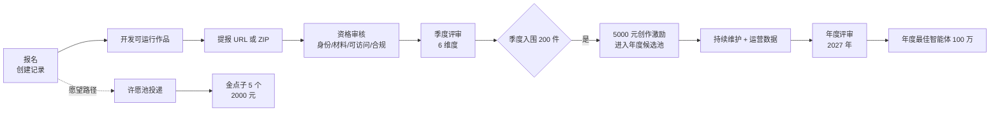
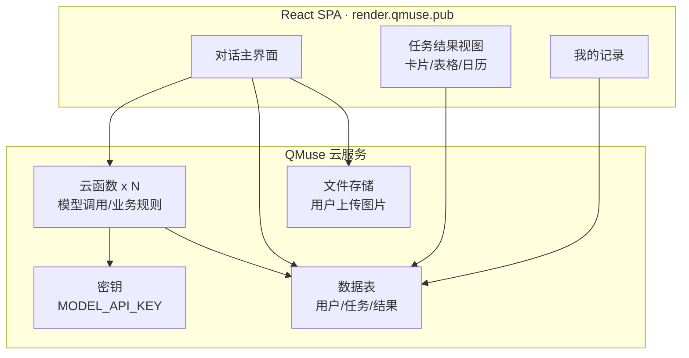

# 支付宝「智能体涌现奖」第一赛季 · 参赛资料包

> 整理时间：2026-10-26
> 来源标记：`[细则]`=官方比赛细则语雀文档 · `[官网]`=赛事官网文案 · `[QMuse]`=QMuse 帮助文档 · `[实测]`=下载官方模板/扫描文档所得 · `[推断]`=无直接证据的推断
> 赛事官网：https://emerge.alipay.com/#/?section=awards

---

## 0. 一页速览

| 项 | 内容 |
|---|---|
| 赛事名称 | 智能体涌现奖（第一赛季） |
| 主办方 | 杭州云坞科技有限公司 `[细则]` |
| 权益提供方 | 支付宝（杭州）数字服务技术有限公司 `[细则]` |
| 赛事主题 | 为新的可能，无尽涌现 `[官网]` |
| 总奖池 | 1000 万元智能体发展奖金 `[细则]` |
| 最高单项 | 年度最佳智能体 1 名，100 万元 `[细则]` |
| 赛季安排 | 季度赛 ×4 + 年度评选；现存第一赛季 |
| 报名/投递窗口 | 2026-09-10 起 至 2026-12-06 23:59:59（北京时间）`[细则]` |
| 评审 | 2026-12-07 至 12-15 `[细则]`；赛果 12 月底公布 |
| 季度入围 | 200 件作品 × 价值 5000 元创作激励 `[细则]` |
| 愿望奖 | 5 个金点子 × 价值 2000 元愿望激励 `[细则]` |
| 参赛形态 | 可运行的智能体（Agent / 智能应用 / 网站 / 小程序 / Skill 等） |
| 提交物 | 可访问 URL **或** ZIP 包（二选一）+ 说明材料 `[细则]` |
| 评委 | 季度：1 内部 + 1 外部；年度：多名外部专家 + 内部 `[细则]` |
| 联系 | ai-agent-contest@alipay.com；客服 95188（8:00–24:00）；官方钉钉群 `[细则]` |

---

## 1. 赛制与定位

- **滚动赛制**：每季度独立征集、评审、颁奖；四期入围作品自动进入年度候选池，2027 年统一决出年度最佳智能体。`[细则]`
- **双参与路径**：`作品参赛`（开发提交可运行作品）与 `蚂蚁阿宝许愿池`（提需求愿望）。**提交愿望不视为提交作品**，不自动获得作品相关权益。`[细则]`
- **作品可被平台调用**：优秀作品有机会被支付宝「蚂蚁阿宝」主对话调用，接入真实场景、获得流量与持续运营支持。`[细则]`



---

## 2. 时间线（含口径差异）

| 时间 | 环节 | 说明 |
|---|---|---|
| 2026-09-10 | 赛事启动 / 开放报名与投递 | 官网报名入口 |
| 2026-09-10 → 2026-12-06 23:59:59 | 首轮季度赛作品提交 | 官网另写「12.06 零点截止」，细则为 23:59:59，**按更早口径准备** |
| 2026-12-07 → 2026-12-15 | 专家评审 | 约 10 个工作日完成 |
| 2026 年 12 月底 | 赛果公布 | 200 件作品 + 5 个愿望 |
| 2027.Q4 | 年度最佳智能体评选和颁奖 `[官网]` | 细则七.1.3 写「2027 年 11 月」综合评审 |
| 2027（未定） | 第二/三/四季度赛 | 待开启 |

---

## 3. 两大参赛方向

> 细则原文：「仅作灵感参考，不构成投稿限制」。`[细则]`

| 方向 | 面向对象 | 口号 | 官方灵感标签 |
|---|---|---|---|
| 生活好帮手 | 普通参赛者、个人开发者、高校学生 | 「我在支付宝把生活玩出花」 | 美食推荐、宠物助手、出行规划、办事指南、生活记账、趣味互动 |
| 消费新体验 | 商家、经营者、服务机构 | 「我在支付宝把生意盘活了」 | 智能客服、复购运营、库存管理、节日营销、差评挽回 |

### 3.1 生活好帮手 · 细则参考方向（1.1–1.10）
1.1 找点乐子：人格测试、兴趣打卡、偶像打卡、互动内容
1.2 吃好每顿饭：菜品推荐、冰箱食材搭配、外食减脂、优惠决策
1.3 把毛孩子伺候好：宠物饮食、宠物出行、宠物友好地图
1.4 把娃带明白：辅食搭配、亲子活动、育儿费用管理
1.5 把日子过好：家务安排、收纳规划、家庭采购与记账
1.6 把钱花明白：比价、优惠提醒、**订阅审计**、消费决策
1.7 出门不慌：旅行清单、通勤规划、停车预测、周末出行
1.8 把事办利索：公共服务材料准备、办事流程指引
1.9 社区互助：社区服务、报修、便民信息、邻里互助
1.10 公益行动：志愿服务匹配、闲置流转、公益决策

### 3.2 消费新体验 · 细则参考方向（2.1–2.3）
2.1 门店经营：智能客服、点单推荐、库存管理、人员排班
2.2 用户运营：会员召回、复购提醒、差评挽回、私域运营、节日营销
2.3 联名命题：围绕合作商家或支付宝业务的真实场景定向创作（有额外资源加持）

---

## 4. 参赛资格 `[细则]`

| 项 | 要求 |
|---|---|
| 开放主体 | 普通个人、个人开发者/超级个体(OPC)、高校学生、商家与企业团队、其他符合条件的智能体创作者 |
| 团队规模 | 2–4 人（个人亦可） |
| 排除 | 阿里巴巴集团与蚂蚁集团全体员工（含实习生、外包）不得参与入围与评奖 |
| 账号 | 本人合法持有的支付宝账号或赛事平台账号；信息真实完整 |
| 唯一性 | 同一参赛者不得用多账号/虚假身份重复参与同一奖项评选 |
| 实名/入驻 | 账号实名、开放平台入驻、商家认证要求**以报名页面提示为准** |

---

## 5. 参与方式 `[细则]`

### 5.1 两种参赛方式
- **直接原创参赛**：基于自身洞察直接报名并提交作品。
- **响应愿望参赛**：从「蚂蚁阿宝许愿池」选真实需求创作；无需严格按原文实现，愿望提交者不自动成为共同作者；若使用他人完整方案/素材/代码需自行取得授权。

### 5.2 提交方式（二选一）
1. **可公开访问、或经授权可访问的作品 URL**（示例：`https://render.qmuse.pub/p/muse/xx`）
2. **作品 ZIP 压缩包**

### 5.3 工具不限
QMuse 等官方推荐工具**为可选工具**，不构成参赛资格或获奖必要条件；可用其他合规工具完成作品。`[细则]`

---

## 6. 作品硬要求

### 6.1 基本要求（八条，逐条对应审核点）
1. 素材与作品权利合法，不侵犯知识产权/肖像权/隐私权，无不正当竞争与违法内容，且通过主办方审核。
2. 具备**可独立运行、可交互体验、可被调用**的技术特性，符合支付宝内容接入规范。
3. 必须是**可实际运行/访问的智能体**，不是概念描述、效果图或演示文稿。
4. 有清晰目标用户、使用场景与核心任务，能体现 AI 在该场景的独特价值。
5. 投稿及评审期间**保持可访问、可体验**。
6. 提交信息真实、完整、有效。
7. 不得与其他参赛作品重复投递。
8. 符合国家法律法规及支付宝平台规范。

### 6.2 禁止内容（10 条，摘要）
违法/危害公共安全/淫秽暴力赌博毒品/侮辱诽谤歧视骚扰/未经授权的个人信息与肖像声音/侵犯著作权商标专利商业秘密/虚构数据伪造案例/诱导转账与欺诈营销/未经许可提供**医疗、金融、法律**等高风险领域的确定性结论/恶意代码与攻击功能。`[细则 6.4]`

---

## 7. 投稿材料清单 `[细则 6.2]`

| 类别 | 必须提交 | 备注 |
|---|---|---|
| 团队信息 | 参赛者或团队介绍 | 个人写清背景与技术栈 |
| 作品信息 | ①作品名称 ②一句话概括产品形态（App/小程序/网站/Agent/硬件/Skill）③动机或灵感来源 | 名称建议 ≤30 字 |
| 作品本体 | 访问 URL **或** ZIP 包 | 必须可运行 |
| 作品说明 | ①目标用户 + 具体问题（谁在什么情况下遇到什么问题、产品帮他完成什么）②核心功能与使用说明（怎么用、得到什么结果、特色与实际价值）③使用的模型/工具/第三方服务/数据来源 | 三段式，别写愿景 |
| 演示物料 | ①封面图 16:9、≤5MB（必需）②介绍视频 MP4/AVI/MOV、≤500MB（选填）③主办方要求的其他材料 | 视频建议 60–120 秒，先放「问题→3 步操作→结果」 |

**可直接复用的说明结构**（写材料时按此填）：
```
作品名：
形态：Web 智能体 / Agent / 小程序 …
目标用户：
真实问题（场景 + 频次 + 现有替代方案的失败点）：
核心能力（3 条以内，每条一句话）：
使用路径（1→2→3→结果）：
AI 必要性（不用 AI 为什么做不成）：
模型与工具：
数据来源与权限说明：
```

---

## 8. 评审机制 `[细则]`

### 8.1 流程
1. **资格审核**：身份、材料完整性、作品可访问性、基础合规（含是否明显侵权/作弊）。不通过者不进正式评审。
2. **季度评审**：截止后约 10 个工作日出 200 件入围。
3. **年度评审**：四期入围自动进池；2027 年结合运营数据与用户反馈综评。

### 8.2 季度评审 6 维度

| 维度 | 官方说明 | 对我们的含义 |
|---|---|---|
| 用户价值 | 问题是否真实、高频、值得解决 | 选一个已被许愿池/评论验证的痛点，别自创需求 |
| 产品体验 | 是否易用流畅、用户是否愿意持续使用 | 首屏即任务，不要 landing page |
| AI 必要性 | AI 是否创造传统产品难以实现的价值 | 说明「规则/模板做不到什么」 |
| 执行能力 | 洞察深度、实现能力、持续经营意愿 | 展示迭代记录与 roadmap |
| 生态适配性 | 支付宝场景落地与规模化潜力 | 说清可接入阿宝/发现 Tab 的形态 |
| 责任可信 | 安全、合规、隐私、可信保障 | 数据最小化、密钥放云函数、风险声明 |

> 原文注：权重仅为辅助，**单一维度特别突出也可晋级**。

### 8.3 年度评审额外维度
真实用户使用量、留存与持续使用、迭代与问题响应、场景接入与经营进展、商业闭环或社会价值、安全合规与服务稳定性；数据口径与观察周期赛前公布。

### 8.4 评委
季度：1 名内部 + 1 名外部；年度：多名外部行业专家 + 内部评委；存在利益关系须回避；名单与同分规则另行公告。

---

## 9. 奖项与发放

| 奖项 | 数量 | 奖励 |
|---|---|---|
| 年度最佳智能体 | 1 名 | 100 万元 |
| 季度入围奖 | 200 件/期 | 价值 5000 元创作激励 |
| 金点子奖 | 5 个/期 | 价值 2000 元愿望激励 |

- 均为**税前**金额，主办方代扣代缴个税；机构需提供等额合格收据。
- 名单公布后约 **30 个工作日**内发放；逾期不交材料视为放弃。
- 用户支持数据仅作参考，刷量/批量账号数据不计入。

---

## 10. 生态支持（机会性，不承诺）`[细则九]`
1. 流量曝光：支付宝开放平台、蚂蚁阿宝等多渠道推荐
2. 开发支持：社群、官方资料、工具指导、专家答疑
3. 场景接入：对接支付宝业务 API 与 **MCP 服务**，有机会上架发现 Tab
4. 商业合作：商家联名优秀作品可上线商家小程序

---

## 11. 合规与 IP 红线

- **原创性**：全新创作或既有作品均可；既有作品须在投稿期内**实质性功能更新**并说明（仅改名/换封面/改文案不算）。`[细则 6.3]`
- **同版本不重复获奖**：已获季度入围奖的同一版本不得再次拿季度入围奖；实质升级后可再参评。
- **年度池只保留最新版本**：同一作品多季参评，年度候选池仅存最新有效版本。
- **IP 归属**：原则上归原权利人；参赛者授予主办方评审/展示/宣传/接入测试范围内的使用权；商业广告与对外授权需另行协商。`[细则十]`
- **展示**：通过审核的作品将在支付宝客户端与赛事官网展示（含阿宝 AI 对话、发现 Tab、支付宝视频频道）。
- **入围后下架**：需提前通知并经同意，否则取消资格并追回奖励。
- **违规处理**：刷票刷量、虚假身份、伪造数据、抄袭、利用规则漏洞、赌博洗钱等 → 判无效/取消资格/追回奖励/影响账号信用。`[细则十一]`

---

## 12. 技术底座（官方模板实测）

> 官方推荐工具链产出的是 **Web 应用（React SPA）**，不是支付宝小程序。`[实测]`

### 12.1 模板实况（`ZIP 项目模板`，71 文件 / 96 KB）
| 层 | 内容 |
|---|---|
| 前端 | React + Vite + TanStack Router + Tailwind + shadcn/Radix，`package.json` 66 个依赖 |
| 入口 | `index.html` → `src/main.tsx`；路由 `src/routes/index.tsx` + `src/router.tsx` |
| 样式 | `src/styles.css` + `components.json`（shadcn 约定） |
| 后端 | QMuse 云服务（详见 12.3），源码声明、导入时同步 |
| 类型 | `window.__MUSE__`、`window.__TERN__` 由运行时注入，**只读** |
| 校验 | `npm run check` + `npm run build`，再 `qmuse import .` |

### 12.2 命令流 `[实测 README]`
```bash
cnpm install                 # 官方推荐；无 cnpm 用 npm
npm run check && npm run build

qmuse login
qmuse space list
qmuse space use <spaceId>
qmuse import .               # 首次＝创建应用；后续＝新增版本
# 失败时读 .qmuse/last-import-error.json，修复后重跑同一命令
# 公开配置/云确认：qmuse import configure；注意：不存在 qmuse push
```
成功后得到 `render.qmuse.pub/p/muse/xx` 形式的预览地址 —— 直接作为报名表的「作品 URL」。

### 12.3 云服务能力 `[QMuse 云服务文档 + 模板 skill]`
| 能力 | 用途 |
|---|---|
| 数据表（TablesDB） | 业务数据持久化；**表权限在网页端「数据表权限设置」配置**，源码不能替代 |
| 文件存储 | 图片/附件上传 |
| 密钥管理 | 模型 key、支付私钥等；只在云函数读取，**禁止进前端/聊天/日志** |
| 云函数 | 签名、支付回调、数据校验、定时任务、第三方 API 调用 |
| 鉴权 | 服务端 custom-token 才是登录事实；`window.__TERN__` 只是登录分支提示 |
| 多环境 | 测试环境 / 正式环境可切换 |
| 命名要求 | 对外一律称「QMuse 云服务」，不暴露底层 provider 名 |

### 12.4 支付宝能力矩阵（关键结论）

| 能力 | 可用性 | 门槛 / 限制 |
|---|---|---|
| 支付宝支付（标准收款） | 提供「支付宝支付」技能 | 沙箱自动配置（含测试买家账号）；正式需 `APPID + RSA2 应用私钥 + 支付宝公钥`，并开通「AI 付 - 网页应用收款」，提交首页/商品页/**收银台**截图审核；**必须自有域名，QMuse 域名不可过审** |
| 支付宝 Vibe Pay（按钮级付费解锁） | 可用 | 仅 QMuse 网页应用；支付宝扫码建商品并设价；**每账号最多 10 个商品**；创建者账号默认放行，需换账号验证 |
| 发布支付宝小程序 | 可用 | 需绑定小程序主体 + 工具公钥；需隐私政策与**备案**；开放平台审核；未发布前 **50 人/天**、不可搜索推广；域名白名单：`appbase-qmuse.oceanbase.com`、`appio.qmuse.cn` |
| 读取用户账单 / 消费记录 | **不可用** | 模板无任何支付宝业务 SDK；公开能力不含个人账单读取 `[推断]` |
| 芝麻分 / 余额 / 真实姓名 / 手机号 | **不可用** | 需签约授权产品，QMuse 未提供 |
| 支付宝经营数据（订单、评价） | **不可用** | 需商家自有系统导入 |
| 支付宝业务 API / MCP 对接 | 入围后机会性资源 | 赛内不承诺 |

### 12.5 身份与绑定强度
| 强度 | 做法 | 结果 |
|---|---|---|
| 弱绑定（现在就能做） | QMuse 登录态 → 读 `__TERN__.user.clientUser.userId` → 落库 | 账号级隔离，每人只见自己数据；**该 id 是平台账号 id，非支付宝 user_id** |
| 中绑定 | 发布支付宝小程序，调小程序 API 取用户标识 | 需主体 + 备案 + 审核 |
| 强绑定 | 读账单 / 自动代扣 | 做不到：需商户签约产品，赛内无权限 |

---

## 13. 「到底要开发什么」——交付物定义

一句话：**一个点开就能用的 Web 智能体 + 一套说明材料。**



必做模块（首版）：
1. 主对话/主任务界面（90% 用户只走这一条路）
2. 领域 Service（`src/services/*.ts`）+ 类型化 CRUD
3. 2–3 个云函数（模型调用、算分/规则、异步任务）
4. 2–4 张数据表（用户、任务、结果、审计日志）
5. 3–5 条**可演示的完整任务流**（评审真会点）
6. 合规面：隐私声明、风险免责、数据最小化、错误与空状态

明确不做（首版）：支付、小程序发布、多环境运维、账号体系重写。

---

## 14. 选题矩阵（按数据依赖重排）

| 方向 | 赛道 | 支付宝数据依赖 | 首版可行性 | 主要风险 |
|---|---|---|---|---|
| 差评预防官（预测式服务补救） | 消费新体验 | 无（自带/模拟订单） | 高 | 演示需可信数据，B 端获取 |
| 订阅续费侦探（账单审计） | 生活好帮手 | 无（截图/手抄解析） | 高 | 不能自动拦截支付，只能提示与算省钱 |
| 口头约定公证员 | 生活好帮手 | 低（无代扣，只能转账链接） | 中 | 履约闭环缺一角 |
| 家庭 CFO 共同账户 | 生活好帮手 | 无（云表 + AA） | 中 | 多端实时同步成本 |
| 后悔药（拦截真实支付） | — | 需支付环节权限 | **低·不可行** | 支付发生在站外，拦不住 |

---

## 15. 一份可直接执行的 30 天节奏

| 阶段 | 天 | 产出 |
|---|---|---|
| 定位 | D1–D2 | 选定方向、写死目标用户与一句话价值、定 3 条演示任务流 |
| 骨架 | D3–D5 | 模板跑通、`qmuse import` 出预览 URL、云服务初始化 |
| 核心 | D6–D14 | 主流程可用（能完整跑通 1 条任务流） |
| 打磨 | D15–D20 | 3 条任务流 + 空/错/慢状态 + 移动端适配 |
| 材料 | D21–D24 | 说明文档、16:9 封面、60–120 秒演示视频 |
| 提报 | D25–D28 | 提交作品、自测「陌生人能否 30 秒上手」 |
| 缓冲 | D29–D30 | 修阻断问题，确认评审期可访问 |

---

## 16. 待确认与风险清单

1. 报名页对**实名 / 开放平台入驻 / 商家认证**的具体要求未在细则写死 → 报名时以页面提示为准。
2. 截止时间口径差异（官网「12.06 零点」vs 细则「12.06 23:59:59」）→ 按 12-05 完成提交。
3. 正式收款需**自有域名**，QMuse 域名不可用于「AI 付」开通审核。
4. 支付宝小程序未发布前 50 人/天、不可搜索，不适合作为首版唯一形态。
5. 年度评审的数据口径、观察周期未公布（入围后才需要关注）。
6. 若用既有作品参赛，必须做出**实质性功能更新**并写清更新点，否则资格审核风险。

---

## 17. 来源

- 赛事官网（奖项/赛道/日程/如何创作）：https://emerge.alipay.com/#/?section=awards
- 比赛细则（语雀）：https://www.yuque.com/shanxian/dfe94a/xzter263dyio4ge3
- 投递周期延长公告：https://www.yuque.com/shanxian/dfe94a/xgqqg05f9n3l6lzg
- QMuse 产品介绍：https://www.qmuse.cn/product-intro
- QMuse 帮助文档：https://docs.qmuse.cn/ （云服务 `/docs/cloud/`、支付宝支付 `/docs/alipay-payment/`、Vibe Pay `/docs/alipay-vibe-pay/`、支付宝小程序 `/docs/publish-miniapp-alipay/`、域名白名单 `/docs/alipay-domain/`）
- QMuse-CLI 文档：https://docs.qmuse.cn/docs/qmuse-cli
- ZIP 项目模板（实测下载解包）：https://mdn.qmuse.zone/qmuse/afts/file/xZ55TpD_4kQAAAAAReAAAAgADTZvAQJr
- 活动规则链接（报名弹窗内）：同上细则
